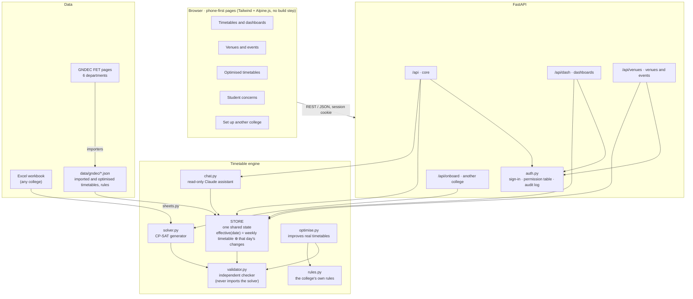
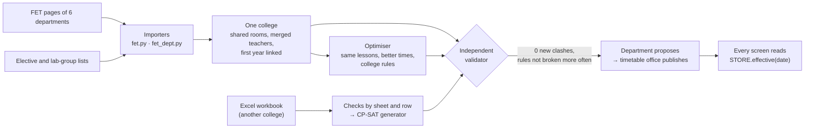

<div align="center">

# TimeWeave

**Clash-free timetables for a whole college, and the everyday campus problems around them.**

Built on the real timetables of all six departments of **Guru Nanak Dev Engineering College (GNDEC), Ludhiana**. Any other college can set itself up from a single Excel workbook.

[](https://timeweave-3y2g.onrender.com)


**[Open the live demo →](https://timeweave-3y2g.onrender.com)**

<sub>Free server: if nobody has used it for a while, the first visit takes about a minute to wake up.</sub>

</div>

---

## The problem

A college timetable is made by hand, once a semester, over weeks. It still ends up with clashes, students waiting hours between lectures, days with no lunch break, and teachers running four lectures in a row. Nobody dares move a class, because one change sets off ten more.

Around the timetable, simple everyday questions have no answer:
- *Which room is empty right now, so I can sit and study?*
- *When is my teacher free?*
- *Who takes this class while a teacher is on leave?*
- *Can our club book the seminar hall?*
- *When is the whole batch free for a visiting company's talk?*

## What TimeWeave does

### The timetable
| | |
|---|---|
| **Real data, not a toy** | Imports GNDEC's own published timetables of **CSE, IT, ME, CE, ECE and EE**: **2,579 classes a week**, merged into one college. Shared classrooms, teachers who teach in two departments and first-year students taught by several departments are all linked up. |
| **Clash-free, proven independently** | Timetables are made with Google OR-Tools **CP-SAT**. Every timetable, whether generated, imported, optimised or edited, is checked by a **separate validator that shares no code with the solver**. A "0 clashes" claim only ever comes from the validator. |
| **Better timetables, same teaching** | Each department's real timetable is re-optimised: same subjects, teachers, groups and rooms, only better times. It is **never worse than the college's version on any measure** and **adds no clash anywhere in the college**. |
| **Real students** | In 3rd and 4th year, "group A2" means different people for different electives. TimeWeave models each real **combination of electives and lab groups**, built from the department's lists, so no real student ever has two classes at once. |
| **The college's own habits** | Rules like *"a teacher's lab for two groups goes on different days"*, *"no class after JPAL"* and *"a real class every working day"* are written in a JSON file. The optimiser follows them, an independent check counts every break, and publishing is refused if any rule is broken more often than in the college's own timetable. |
| **Any college** | Another college downloads a template, fills in rooms, teachers, classes and subjects, and uploads it. Every mistake is explained by sheet and row ("Lessons row 12: teacher 'XYZ' is not on the Teachers sheet"), and then it gets a clash-free timetable to view and download as Excel. No account needed. |

### Around the timetable
| | |
|---|---|
| **Free rooms** | Rooms empty right now, or at any period, by building and floor, and how long they stay free. |
| **Teacher free slots and meetings** | See when a teacher is free and request a meeting. The teacher accepts or declines, and the student is notified. |
| **Leave and substitutes** | Mark a teacher on leave for a date and get substitutes ranked by who is free, teaches the same subject, is in the same department and already knows the students, with fairness across the month. |
| **Venue booking** | Clubs request seminar halls and rooms. Venues are ranked by fit, endorsed by the club's faculty advisor, then approved by the HOD who owns the room (the timetable office approves central halls). |
| **Event slot finder** | A visiting organisation or the placement cell finds a time when a whole batch is free, plus a venue. |
| **Student concerns** | Students report what makes them miss classes ("8:30 is too early for my bus", "no break on Tuesday"). Classmates add "me too" instead of duplicates. Staff see counts per class, never names, and their answer notifies everyone who agreed. |
| **Ask AI** | A Claude assistant answers questions like *"When is my first class on Monday?"* from live data through read-only tools. It can never change anything. |
| **Roles and audit log** | 8 roles with sign-in, a server-side permission table (deny by default) and an audit log of every privileged action. |

## Results on GNDEC's real timetables

The whole college as published, checked by the validator: **0 student clashes, 0 room clashes.** It also has 5 teacher double-bookings, which are in the published data itself: mostly one combined class listed by two departments. TimeWeave never adds to them.

Each department optimised, with the rest of the college held fixed:

| Department | Student waiting periods / week | Teacher waiting periods / week |
|---|---|---|
| CSE | 181 → **153** | 314 → **200** |
| IT | 15 → **11** | 151 → **96** |
| ME | 21 → **18** | 172 → **118** |
| CE | 6 → 6 | 136 → **72** |
| ECE | 15 → **0** | 105 → **52** |
| EE | 25 → **0** | 129 → **62** |
| **All six** | **263 → 188 (−29%)** | **1,007 → 600 (−40%)** |

- **CSE days with no lunch break: 44 → 0.**
- **569 classes moved, 0 new clashes anywhere in the college** (checked by a test that drops each optimised department back into the whole college).
- First year, classes taught by other departments, mentoring and M.Tech/PhD classes stay exactly as published.

## Architecture



### How a timetable is made and trusted



### Design rules the code keeps
1. **The validator is independent of the solver.** It never imports OR-Tools or solver code, and tests inject every kind of clash to prove it catches them.
2. **One shared state.** Every screen, free-room search, venue check and chatbot answer reads the same `STORE.effective(date)`: the weekly timetable plus that date's changes (cancellations, substitutes, room changes, bookings).
3. **The server decides permissions.** Every action is a row in one table in `app/auth.py`, and anything not listed is refused. The pages only hide buttons; the server is the gate.
4. **The assistant never changes anything.** It has read-only tools.
5. **Departments propose, the timetable office publishes.** Publishing is refused if the timetable adds a clash or breaks a college rule more often than before.

### The solver in one paragraph
One true/false variable for each class and each possible day, start time and (for labs) room. **Hard rules:** no teacher, student group or room in two places at once; teacher availability; a theory subject at most once a day; labs as 2-hour blocks; a free lunch hour somewhere in 11:30–2:30 for every student and teacher. **Goals it minimises:** students waiting between classes, days with a single lecture, teachers waiting, and more than three classes in a row. Before solving, prechecks explain in plain words why a timetable is impossible (e.g. "X is assigned 26 hours but can teach at most 24").

## Roles

| Role | What they do |
|---|---|
| **Student** | My timetable, free rooms, teacher free slots and meetings, student concerns, Ask AI |
| **Teacher** | My schedule, meeting requests, mark leave, request venues, endorse club requests (faculty advisors) |
| **Timetable coordinator** | Their department's timetable: substitutions, optimised timetable |
| **HOD** | Everything for their department: substitutions, approving their department's halls, proposing the optimised timetable, answering concerns |
| **Dean** | Sees everything, changes nothing |
| **Club lead** | Requests venues for events |
| **Visitor / Training & Placement** | Event slot finder and venue requests |
| **Timetable office** | Publishes timetables, approves central halls, sees and answers all concerns, audit log |

On the live demo, sign-in needs no password: pick a role and, for students, your department, year, section and electives.

## Try it in two minutes

1. Open **[the live demo](https://timeweave-3y2g.onrender.com)**, choose **Continue as GNDEC Ludhiana**, then **Student** → CSE → 4th year → D4 CS A → **Show my timetable**.
2. Open **Free rooms** and look at **right now**.
3. Click **Ask** and ask *"When is my first class on Monday?"*.
4. Switch to **HOD** → CSE and open **Optimised timetables**: the college's version next to the optimised one, measure by measure, with the college rules.
5. Go back to the start, choose **Set up a different college**, click **Try it with the sample college**, then **Make the timetable**.

## Run it locally

```bash
python -m venv .venv
.venv/Scripts/python -m pip install -r requirements.txt    # on Linux/macOS: .venv/bin/python
copy .env.example .env                                     # optional: ANTHROPIC_API_KEY for Ask AI
.venv/Scripts/python -m uvicorn app.main:app --port 8001
```

Open http://localhost:8001. Other commands:

```bash
.venv/Scripts/python -m pytest -q                                   # 138 tests
.venv/Scripts/python -m app.importers.fet_dept ALL                  # re-import IT, ME, CE, ECE, EE from their FET pages
.venv/Scripts/python -m app.optimise 300 ALL                        # re-optimise every department (5 minutes each)
.venv/Scripts/python -m app.importers.sheets data/colleges/demo_institute/demo_institute.xlsx   # another college from Excel
.venv/Scripts/python -m app.importers.sheets --template college_template.xlsx                  # a blank template
```

**Deploy:** the `Dockerfile` runs anywhere that runs containers (the live demo is on Render). `TIMEWEAVE_HOSTED=1` switches off the multi-minute optimiser re-runs, and `ANTHROPIC_API_KEY` goes in the host's environment variables, never in the repo.

## Tech stack

| Layer | Choice |
|---|---|
| Backend | Python 3.12+, FastAPI |
| Solver | Google OR-Tools CP-SAT |
| Front end | Plain HTML, Tailwind CSS and Alpine.js from a CDN; no build step, mobile-first |
| State | In memory, saved to JSON files |
| Assistant | Anthropic Claude (`claude-opus-5-5`) with read-only tools |
| Tests | pytest: **138 tests**, including clash injection for the validator, permissions on all 50 API routes, and "no new clash in the college" for each optimised department |

## Project layout

```
app/
  main.py             the web app: pages and routers
  auth.py             sign-in, the permission table, audit log
  store.py            the one shared state: timetable + date changes, requests, notifications
  solver.py           CP-SAT timetable generator with plain-language prechecks
  validator.py        independent clash checker and quality measures
  optimise.py         improves each department's real timetable
  rules.py            the college's own timetable rules
  substitutions.py    ranked substitutes for teachers on leave
  chat.py             the read-only assistant and its tools
  importers/          FET pages (fet.py, fet_dept.py), student lists, Excel workbooks (sheets.py)
  api/                core, dashboards, venues, onboarding (another college)
  venues/             venue ranking, approval chain, event slot finder
  static/             the pages: timetable, venues, sign-in, optimised timetables, concerns, audit, set-up
data/
  gndec/              GNDEC: raw FET pages, imported and optimised timetables, rules, student-group counts
  colleges/           blank Excel template and sample colleges
tests/                138 tests
docs/                 design, API, and the full project report
```

## Data and privacy

- **GNDEC's timetables** come from the pages each department publishes (`data/gndec/raw/`); the cleaned files are in `data/gndec/`.
- **Student lists** with names and roll numbers are used only on the machine that imports them and are **never committed**. Only anonymous counts per combination of electives are stored (`data/gndec/students.json`).
- **Sample colleges** in `data/colleges/` are made up. The Thapar sample follows Thapar's style but is not its real timetable.
- **Uploaded workbooks** from another college are not stored on the server.

## Honest limits and what's next

- A college set up from Excel gets its timetable today. The other features (free rooms, meetings, venues, concerns, Ask AI) work on the same kind of data, and the next step is to load the uploaded college into the full app with its own accounts.
- The week is Monday to Friday with up to 8 periods; moving the grid into each college's profile is planned.
- Sign-in is a no-password demo; college Google sign-in is planned.
- Planned: import from FET project files, a manual timetable editor with live clash checks, and rule editing from the app.

## Documentation

- [`docs/HACKATHON_REPORT.md`](docs/HACKATHON_REPORT.md): the full project report: every feature, number and test
- [`docs/DESIGN.md`](docs/DESIGN.md): detailed design
- [`docs/API.md`](docs/API.md): API reference
- [`PLAN.md`](PLAN.md): plan and status
- [`CLAUDE.md`](CLAUDE.md): architecture rules and domain glossary for contributors
